# Projects

## Oasis
[Download](https://github.com/VINKAS7/Oasis/archive/refs/heads/main.zip)
[GitHub Repository](https://github.com/VINKAS7/Oasis)
VINKAS7/Oasis

Oasis turns a local business website into tools that ChatGPT, Claude and Gemini can use to find the business, show what it offers and take orders.

People have started asking their AI assistant instead of searching the web. "Where is the nearest pizza?", "Find me a black hoodie in size L", "Book a room near Basel for Friday". The assistant can read a website, but it cannot really use it: it can't open the menu as something you can pick from, it can't place an order, and it often doesn't know the shop exists at all. Small businesses are the ones who lose out, because they don't have the time or money to build an app for every new platform.

Oasis fixes that from the business side. The owner signs up and either gives us their website or builds a small shop directly in Oasis. We read the site, work out what a customer would want to know or do (the menu, prices, opening hours, booking a table), and turn each of those into a tool. Every tool is checked for security and tested against the real site before it goes live. With one click the business gets its own MCP server and also appears in the shared Oasis directory that any assistant can connect to.

On the customer side nothing new has to be installed. You add the Oasis connector to ChatGPT, Claude or Gemini once, and from then on you just ask. The answer comes back as cards inside the chat: places on a live Google map, menus and products with photos and prices, questions you answer with one tap. When you want something, the order goes straight to the owner's inbox and they accept or decline it. There is also a public chat page on the Oasis site for people who don't use an assistant yet.

### Motivation
It started with something we had all noticed: people don't search the way they used to. Instead of typing into Google and clicking through five websites, they ask ChatGPT or Claude "where can I get a good pizza near Barfüsserplatz?" and go with whatever it answers. Big chains are already getting ready for that. A bakery in Kleinbasel or a family guesthouse in Reinach is not. Their website took years to get right and is often the only online presence they have. An assistant can read it, but it can't really use it: it can't show the menu as something you pick from, it can't tell whether the place is open right now, and it can't place an order.

We didn't want to tell those owners to build yet another app, or to pay for ads just to be visible to AI. With Oasis they keep the website they already have, and it starts working inside the conversation, while the owner still decides what gets ordered or booked. That was exactly the question behind the Adobe challenge at BaselHack 2026, "The Post-Website Business", so it was an easy choice.

Switzerland made it harder, in a good way. In Basel alone one customer writes in German, the next in French or Italian, and plenty of people just use English, while the shop's own website is usually in one language only. So Oasis had to understand all of them from day one, know that "Haarschnitt", "coupe de cheveux" and "haircut" are the same thing, and still pick the right business and the right item every time.

### How it works
**For the owner**
- **Website reading.** A Playwright crawler visits up to 30 pages of the site (respecting robots.txt), and an AI model sorts what it finds into *tools ready* (read only: menu, prices, hours, contact) and a *to-do list* of actions only the owner can show us, like a booking form.
- **Recorder.** For those actions there is a Chrome extension. The owner does the task once on their own site and the recording becomes a tool.
- **Shops without a website.** Four templates (clothing, food menu, services, general shop). Products with photos, prices, sizes, colours and stock per variant.
- **Checks before going live.** Every tool gets a security scan (allowed hosts, personal data, prompt injection in the page text) and a real test run. Only tools that pass are published. Every change is a new version you can roll back.
- **Publishing.** One click gives the business its own MCP server at `/mcp/b/<business_id>` and lists it in the shared directory at `/mcp`. Orders land in an inbox where the owner accepts or declines them.

**For the customer**
- **Search by meaning and by words.** Businesses and items are found with BM25 keyword search plus embeddings (qwen3-embedding on a local Ollama). The keyword side knows synonyms in English, German, French and Italian ("Haarschnitt", "coupe de cheveux" and "taglio" all mean haircut), so search keeps working even if the embedding model is down.
- **No guessing.** If a name could mean two businesses ("Café Central" or "Café Centrale"), the assistant is told it's ambiguous instead of being given the wrong one. Item names typed in any case or with or without accents are matched, and sizes and colours are checked against stock.
- **Cards in the chat (MCP Apps).** Places with an interactive Google map and numbered pins, catalogs with search, filters and a photo viewer, a business card with "open now" and the week's hours, and question cards (yes/no, choices, budget sliders, ratings, dates).
- **The Oasis chat.** A public chat page with its own agent. It repairs bad model answers instead of failing, never claims an order was placed unless a tool really did it, and every order still needs the customer's click on a confirm button.
- **Quality you can see.** The admin panel has a Chat quality page with success rate, AI calls and time per answer, and a step by step trace of every answer.

We test all of this with 118 automated tests and a live evaluation of 29 conversations in four languages. On the last run Oasis found the right business and the right item every time, got every order to the confirm step, and answered in 3.4 seconds (median).

### Technologies Used
- Python, FastAPI, SQLite
- MCP Python SDK with the MCP Apps extension (cards inside ChatGPT, Claude and Gemini Enterprise)
- React, TypeScript, Vite, Tailwind CSS
- better-auth (Node) for accounts and sessions
- Playwright for crawling and for the recorder replays
- Google Maps JavaScript API for the interactive maps
- Ollama with qwen3-embedding for search by meaning
- Any OpenAI compatible or Anthropic model for the AI tasks, chosen per task in the admin panel (we used GLM 5.3 Flash on the KIT AI Toolbox)
- ngrok to give the local server a public address for the assistants

### Setup Instructions
You need Node 22+, Python 3.11+ and [uv](https://docs.astral.sh/uv/).

1. Install everything. This also creates `auth/.env` and `backend/.env` with fresh secrets and downloads Chromium for the crawler.
```
npm install
npm run setup
```
2. Start the auth service, the API and the web app. The app runs at http://localhost:5173 and the customer chat at http://localhost:5173/chat.
```
npm run dev
```
3. Optional: to use Oasis from ChatGPT, Claude or Gemini, put your public ngrok address in `PUBLIC_API_URL` in `backend/.env` and start with the tunnel. Add your Google Maps key as `GOOGLE_MAPS_API_KEY` in the same file for the interactive maps.
```
npm run dev:public
```

After signing up, make yourself admin with `npm --prefix auth run make-admin -- you@example.com`, then add an AI provider under **Admin, AI providers**. The connector address for the assistants is `<PUBLIC_API_URL>/mcp`. More details about the architecture and every part of the system are in [docs/DEVELOPMENT.md](docs/DEVELOPMENT.md).

To run the tests:
```
uv --directory backend run pytest -q
```

### Demo/Screenshots
A customer asks for the nearest pizza and then for the menu, all inside a chat.

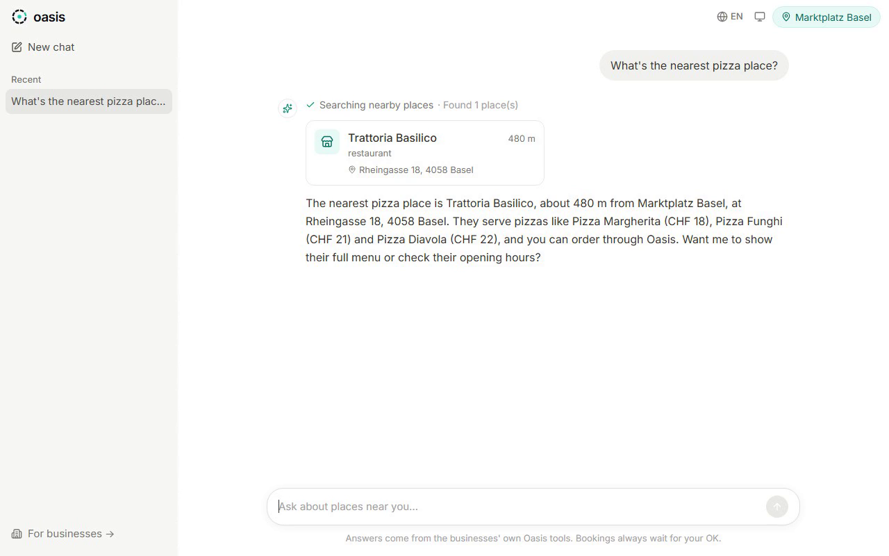
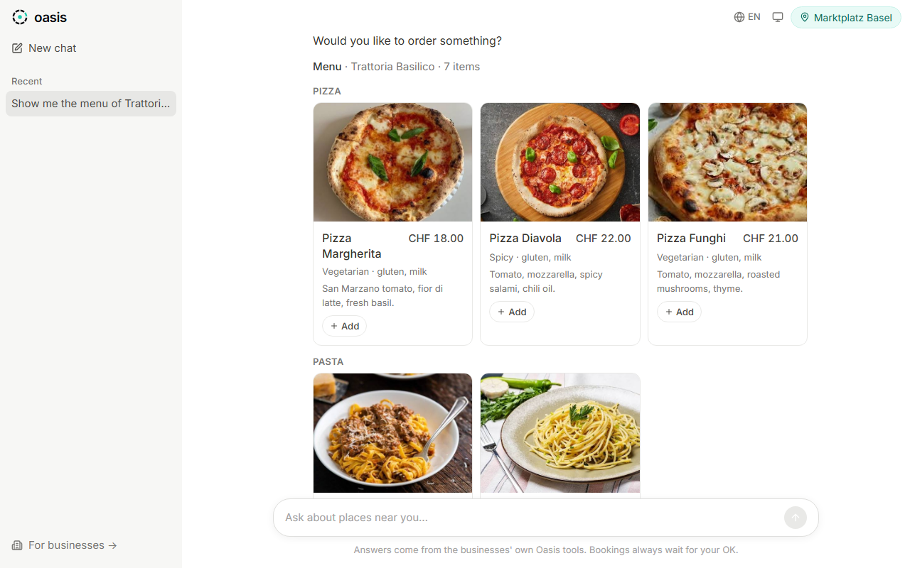
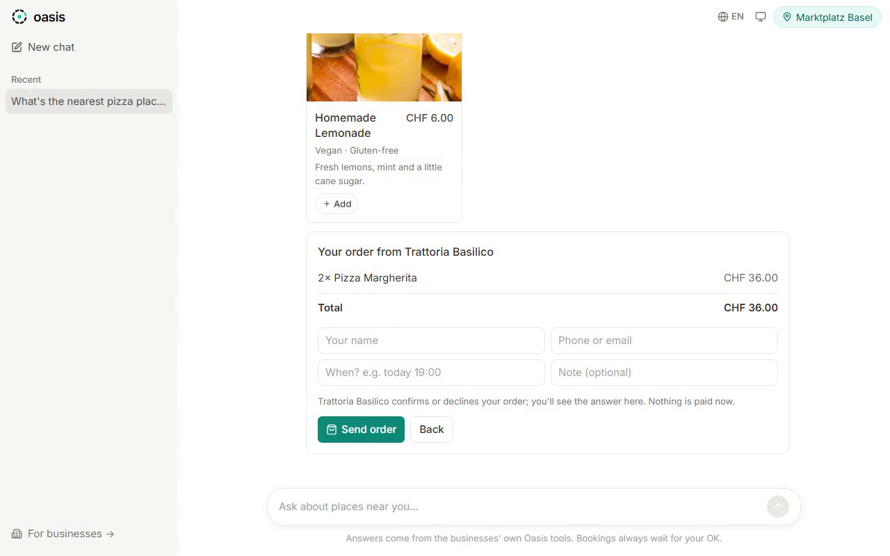

The same results as cards inside Claude or ChatGPT: places on a live Google map, a business card with today's hours, and questions you answer with a tap.

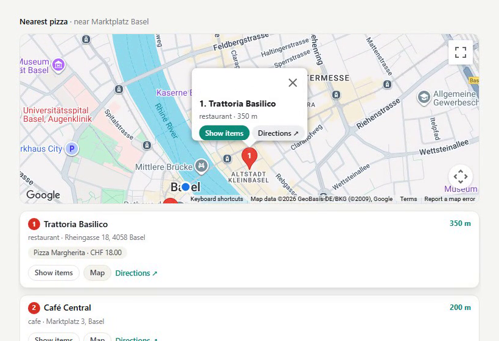
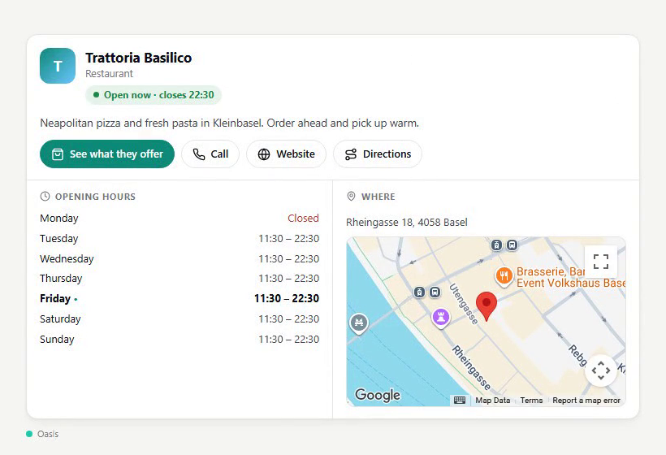
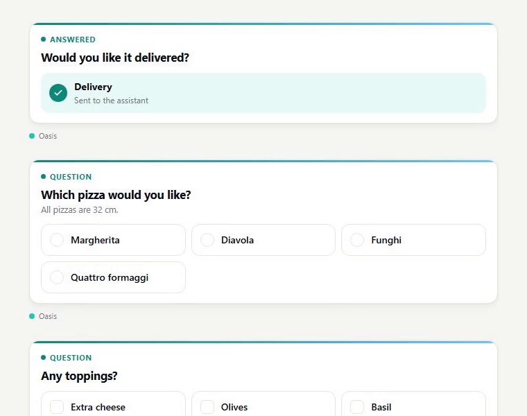

For the owner: Oasis reads a real guesthouse website and suggests tools, a shop goes live as its own MCP server, and a restaurant's menu in its workspace.

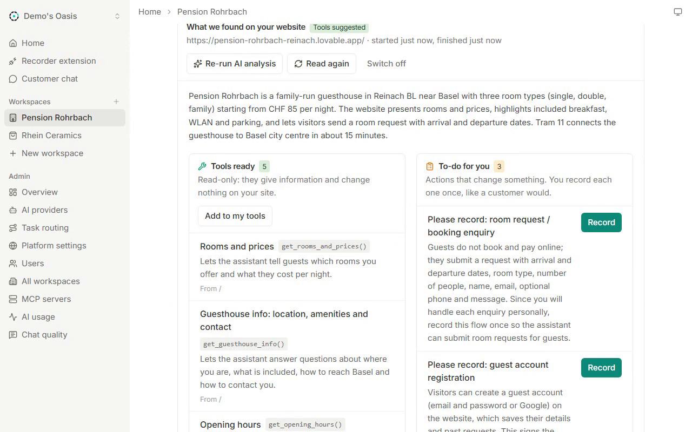
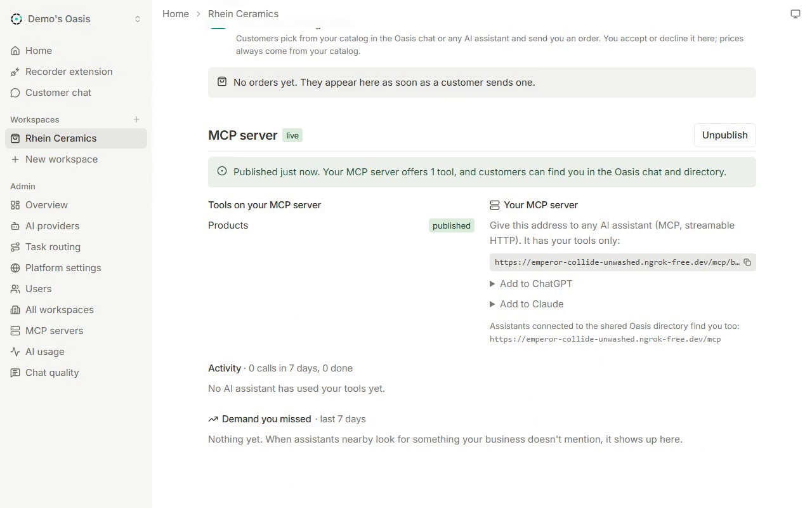
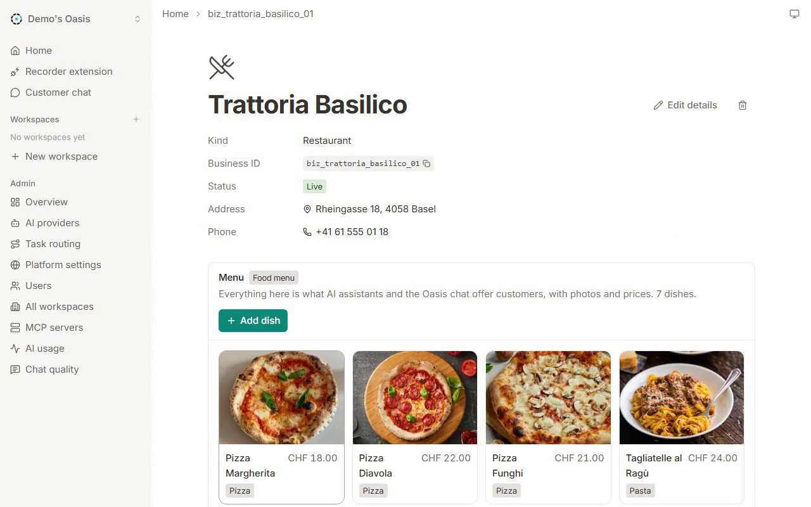

The connect page for assistants and the Chat quality page for admins.

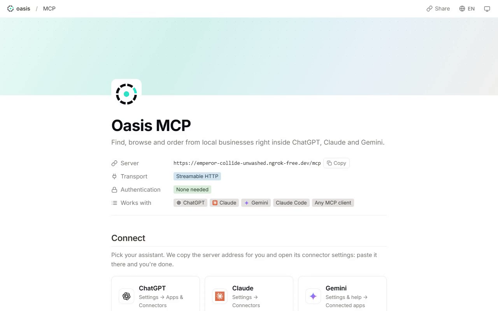
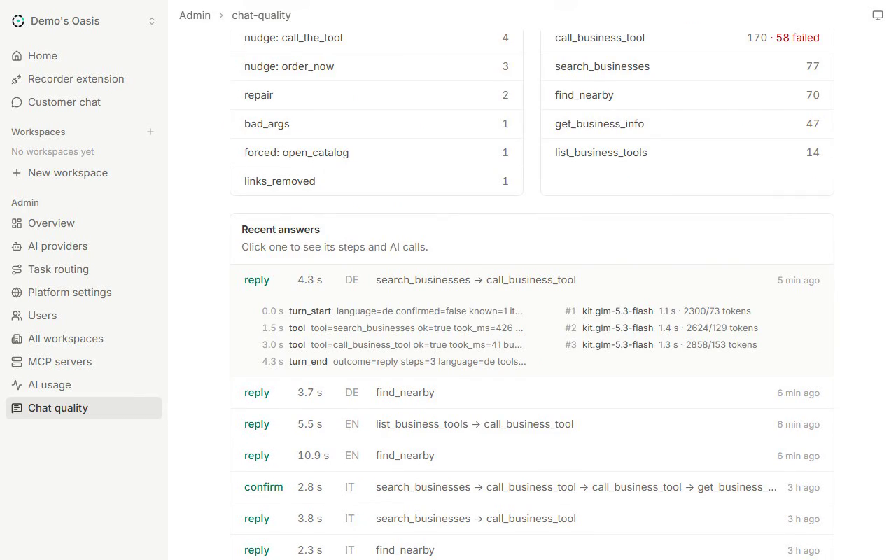

- The customer chat answers in English, French, Italian or German and remembers the language you pick.
- The connect page at `/mcp` shows how to add Oasis to ChatGPT, Claude, Gemini or Claude Code, and has example prompts to try.

### Awards/Achievements
Built at BaselHack 2026 for the Adobe challenge "The Post-Website Business".

### Contributors
Vinayak Kashyap, Sameer Phaniraj Kumble, Tomas Strnadel, Jonas Rohrbach

### Additional Notes
The public address in this repo is a free ngrok domain that only works while one of us has the server running. For real use, Oasis should run on a server with its own domain, and the Google Maps key should be restricted to the Maps JavaScript API.

Next we want to let owners record bookings and orders for more types of sites, add payments for orders, and get Oasis into the official app directories of ChatGPT and Claude so customers can add it without developer mode. Cards don't show in the regular Gemini app yet, so there Oasis answers in plain text.
